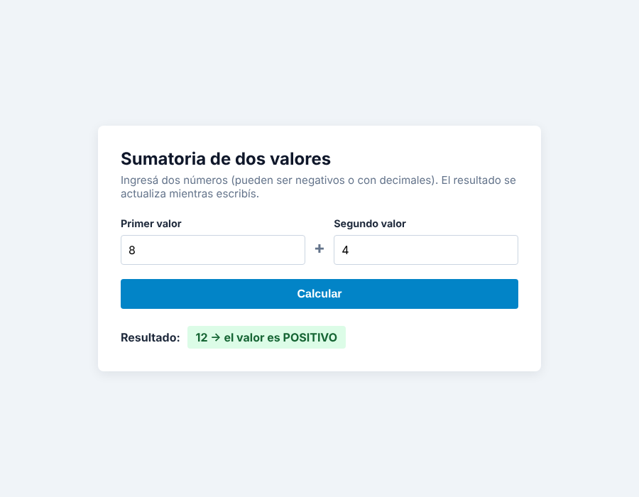
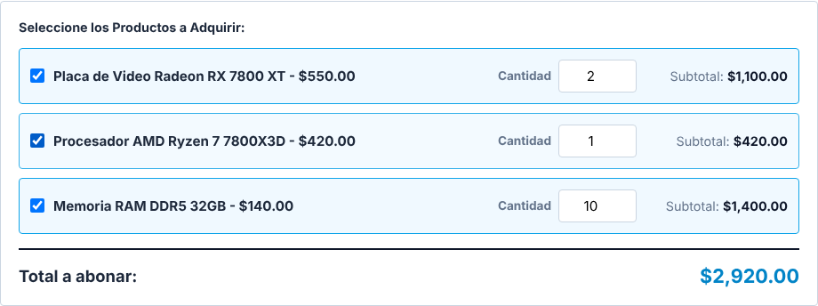

# AA13 — Primeros pasos con JavaScript Vanilla: eventos, lectura de datos y mutación del DOM

**Objetivo:** pasar de la interfaz estática del TP1 (HTML/CSS) a la capa de comportamiento con JavaScript Vanilla. Se trabajan tres cosas:
- capturar eventos del usuario;
- leer datos de entrada;
- modificar el árbol DOM **sin recargar la pestaña**.

Las dos partes se abren directamente en el navegador, sin servidor.

```
AA13-dom-eventos/
├── parte-a/   index.html · suma.js · estilos.css       → algorítmica
└── parte-b/   comprar.html · subtotal.js · subtotal.css · estilos.css → TP1
```

---

## Parte A — Algorítmica: sumatoria de dos valores

**Archivo:** [`parte-a/index.html`](parte-a/index.html) + [`parte-a/suma.js`](parte-a/suma.js)



### Paso a paso

**1. Capturar dos valores de `<input type="number">`.**

```js
const inputUno  = document.querySelector('#valor1');
const inputDos  = document.querySelector('#valor2');
const resultado = document.querySelector('#resultado');

const valorUno = parseFloat(inputUno.value);
const valorDos = parseFloat(inputDos.value);
```

`.value` siempre devuelve **texto**, aunque el input sea de tipo número. Sin `parseFloat`, `"5" + "3"` daría `"53"` (concatenación) en lugar de `8`.

**2. Calcular la sumatoria en memoria.**

```js
const suma = Math.round((valorUno + valorDos) * 100) / 100;
```

El resultado queda en una variable, es decir, en memoria RAM. El redondeo a 2 decimales evita el error de coma flotante de JavaScript: `0.1 + 0.2` da `0.30000000000000004`.

**3. Inyectar el resultado en `<span id="resultado">` indicando el signo.**

```js
if (suma > 0) {
  resultado.textContent = `${suma} → el valor es POSITIVO`;
  resultado.classList.add('positivo');
} else if (suma === 0) {
  resultado.textContent = `${suma} → el valor es CERO`;
  resultado.classList.add('cero');
} else {
  resultado.textContent = `${suma} → el valor es NEGATIVO`;
  resultado.classList.add('negativo');
}
```

Además del texto, se aplica una **clase CSS** distinta para cada caso: verde para positivo, gris para cero y rojo para negativo.

**Eventos:**
- El cálculo se dispara con el botón **Calcular** (evento `submit` con `preventDefault()`, para que el formulario no recargue la página).
- También se dispara **en tiempo real** con el evento `input` de cada campo.

**Validación:** si algún campo está vacío, `parseFloat` devuelve `NaN`. En ese caso no se calcula y se muestra "Completá ambos valores".

| Valores | Resultado |
|---|---|
| 15 + 20 | 35 → POSITIVO |
| 5 + (-5) | 0 → CERO |
| 3 + (-10) | -7 → NEGATIVO |
| 0.1 + 0.2 | 0.3 → POSITIVO |
| 7 + *(vacío)* | Completá ambos valores |

---

## Parte B — Aplicación en el proyecto del TP1: subtotal en tiempo real

**Archivo:** [`parte-b/comprar.html`](parte-b/comprar.html) + [`parte-b/subtotal.js`](parte-b/subtotal.js)

Se tomó la pantalla **Comprar** del maquetado del TP1 (`comprar.html` de la raíz del repositorio) y a cada producto se le agregó un campo de cantidad, su subtotal y un total general.



### 1. Campo de cantidad de cada producto

```html
<div class="producto-fila" data-precio="550">
    <label class="checkbox-item">
        <input type="checkbox" name="productos[]" value="RX 7800 XT">
        Placa de Video Radeon RX 7800 XT - $550.00
    </label>
    <div class="producto-cantidad">
        <label for="cant-rx7800xt">Cantidad</label>
        <input type="number" id="cant-rx7800xt" class="input-cantidad" min="0" max="10" value="0">
    </div>
    <p class="producto-subtotal">Subtotal: <span class="subtotal-linea">$0.00</span></p>
</div>
```

El precio se guarda en el atributo `data-precio`, así JavaScript lo lee con `fila.dataset.precio` y no tiene que "recortarlo" del texto.

### 2. Captura del cambio en tiempo real

```js
inputCantidad.addEventListener('input', actualizarTotales);
```

El evento **`input`** se dispara con cada tecla y con las flechitas del campo. Por eso el subtotal cambia al instante. Con `change` solo se actualizaría al salir del campo.

### 3. Subtotal y total sin refrescar la página

```js
function actualizarTotales() {
  let total = 0;

  filas.forEach((fila) => {
    const precio   = Number(fila.dataset.precio);
    const cantidad = leerCantidad(fila.querySelector('.input-cantidad'));
    const subtotal = precio * cantidad;
    total += subtotal;

    fila.querySelector('.subtotal-linea').textContent = formatoPrecio.format(subtotal);
  });

  totalCompra.textContent = formatoPrecio.format(total);
}
```

Solo se modifica el texto de los `<span>`: la página **no se recarga**.

### Detalles agregados

- **Cantidades inválidas:** una cantidad vacía o negativa cuenta como 0, y el máximo es 10. Al salir del campo, el valor se corrige solo.
- **Checkbox sincronizado:** el producto se marca solo si la cantidad es mayor a 0. Si se marca el checkbox con cantidad 0, pasa a 1; si se desmarca, vuelve a 0.
- **Fila resaltada:** los productos con cantidad aparecen resaltados, con la clase `producto-fila--activa`.

| Acción | Resultado |
|---|---|
| RX 7800 XT × 2 y RAM 32GB × 3 | Subtotales $1,100.00 y $420.00 · Total **$1,520.00** |
| Marcar el Ryzen 7 (cantidad 0) | La cantidad pasa a 1 · Total **$1,940.00** |
| Escribir 50 en RAM 32GB | Se corrige a 10 · Total **$2,920.00** |
