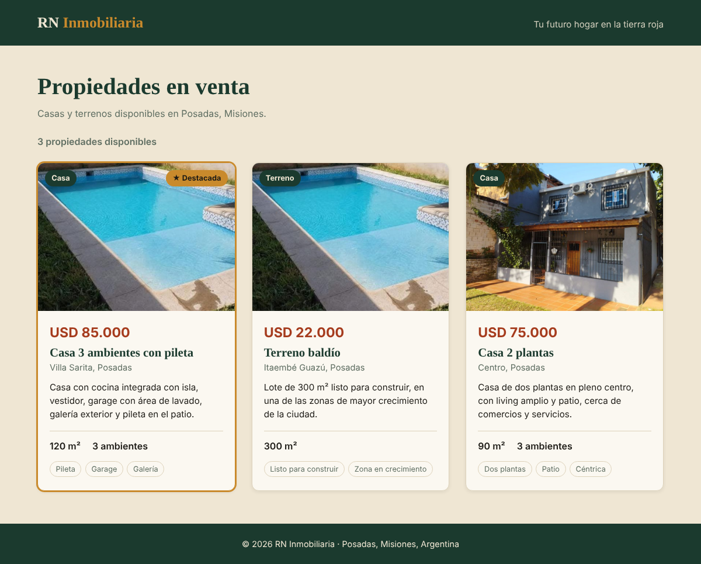

# AA17 — Catálogo asíncrono con fetch y JSON

**Objetivo:** poner en práctica `querySelector`, `addEventListener`, JSON y métodos asíncronos con `fetch` en JavaScript Vanilla.

**Proyecto:** RN Inmobiliaria. Los "productos" del catálogo son las propiedades en venta.



## Estructura

```
AA17-catalogo-fetch/
├── index.html           ← página con el contenedor vacío de la grilla
├── data/productos.json  ← objeto JSON con las propiedades (consigna 2)
├── js/app.js            ← evento load + fetch async/await + creación de tarjetas
├── css/estilos.css      ← estilo de tarjeta
└── img/                 ← fotos de las propiedades
```

## Cómo verlo

`fetch()` necesita que la página se sirva por HTTP. Abriéndola con doble clic (`file://`), el navegador bloquea la lectura del JSON y la página muestra un aviso.

- **Live Server (VS Code):** clic derecho en `index.html` → *Open with Live Server*.
- **XAMPP:** copiar la carpeta a `htdocs` y abrir `http://localhost/AA17-catalogo-fetch/`.

---

## Consigna 1 — Carga a través del evento `load` con `addEventListener`

```js
window.addEventListener('load', cargarProductos);
```

Cuando la página termina de cargarse, el navegador dispara el evento `load` y se ejecuta `cargarProductos()`.

- El HTML **no tiene** `onload` ni `onclick`: la página y la lógica quedan **desacopladas**. La estructura está en `index.html` y el comportamiento en `js/app.js`.
- Para seleccionar los elementos se usa **`querySelector`** con selectores CSS:

```js
const grilla = document.querySelector('.grilla-productos');
const estado = document.querySelector('.estado');
```

## Consigna 2 — Objeto JSON en la carpeta del proyecto

`data/productos.json` es un **objeto** con datos generales (empresa, ciudad, moneda) y un **array de objetos** `productos`, que funciona como una pseudo base de datos:

```json
{
  "empresa": "RN Inmobiliaria",
  "moneda": "USD",
  "productos": [
    {
      "id": "villa-sarita",
      "titulo": "Casa 3 ambientes con pileta",
      "tipo": "Casa",
      "barrio": "Villa Sarita, Posadas",
      "precio": 85000,
      "superficie": 120,
      "ambientes": 3,
      "descripcion": "...",
      "caracteristicas": ["Pileta", "Garage", "Galería"],
      "imagen": "img/villa-sarita.jpg",
      "destacada": true
    }
  ]
}
```

Usa los distintos tipos de dato de JSON:
- **texto** (`titulo`, `barrio`)
- **números** (`precio`, `superficie`)
- **booleano** (`destacada`)
- **`null`** (`ambientes` del terreno, que no tiene)
- **array** (`caracteristicas`)

## Consigna 3 — `fetch` y funciones `async`

```js
async function cargarProductos() {
  try {
    const respuesta = await fetch('data/productos.json');

    if (!respuesta.ok) {
      throw new Error(`HTTP ${respuesta.status}`);
    }

    const datos = await respuesta.json();
    renderizarProductos(grilla, datos.productos, datos.moneda);
  } catch (error) {
    // muestra un mensaje de error en la página
  }
}
```

- **`fetch()`** pide el archivo en **segundo plano**. Mientras tanto la página sigue respondiendo y muestra "Cargando propiedades…".
- **`await`** espera a que la promesa se resuelva, sin bloquear el hilo principal (el **Event Loop** se encarga).
- **`respuesta.json()`** convierte el texto JSON en un objeto de JavaScript.
- **`respuesta.ok`** se revisa porque `fetch` solo falla por errores de red. Un 404 (archivo no encontrado) llega como respuesta "exitosa" y hay que controlarlo a mano.
- **`try / catch`** atrapa cualquier error y muestra un aviso en la página en lugar de dejarla vacía.

## Consigna 4 — Estilo de tarjeta para cada producto

Por cada objeto del array se construye una tarjeta con **`forEach`**:

```js
productos.forEach((producto) => {
  fragmento.appendChild(crearTarjeta(producto, moneda));
});
grilla.replaceChildren(fragmento);
```

Cada tarjeta muestra:
- foto, con etiqueta de tipo (Casa / Terreno);
- precio, título, barrio y descripción;
- superficie y ambientes;
- las características como etiquetas.

La propiedad con `"destacada": true` lleva un borde dorado y la cinta **★ Destacada**.

**Estilo (`css/estilos.css`):**
- Grilla adaptable con `grid-template-columns: repeat(auto-fill, minmax(290px, 1fr))`: tres columnas en escritorio y una en el celular.
- Tarjetas con borde redondeado, sombra y efecto al pasar el mouse (se elevan con `transform: translateY(-4px)`).
- Fotos con la misma proporción (`aspect-ratio: 4 / 3` + `object-fit: cover`), así todas las tarjetas quedan parejas.
- Animación de aparición escalonada y paleta de colores de la marca RN Inmobiliaria.

**Renderizado seguro:** los elementos se crean con `createElement` y el texto se asigna con **`textContent`**, no con `innerHTML`. Como vimos en clase, `textContent` inserta solo texto y evita ataques XSS si un dato del JSON trajera etiquetas HTML. Además, con un `DocumentFragment` las tarjetas se insertan en el DOM **una sola vez**.

## Pruebas

| Prueba | Resultado |
|---|---|
| Abrir con servidor local | Se crean las 3 tarjetas y el estado indica "3 propiedades disponibles" |
| Vista de celular (390 px) | Una columna, sin desplazamiento horizontal |
| Abrir con doble clic (`file://`) | Muestra el aviso de error en lugar de una página vacía |
| Consola del navegador | Sin errores |
