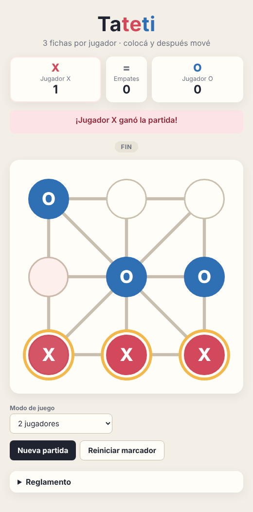

# AA18 — Tateti en HTML, CSS y JavaScript

Juego de **Tateti** con las reglas del reglamento: **3 fichas por jugador**, una fase de colocación y una fase de movimiento.



## Cómo jugar

Abrir `index.html` en el navegador con doble clic: no necesita servidor ni instalación.

## Archivos

| Archivo | Contenido |
|---|---|
| `index.html` | Estructura: marcador, estado del turno, tablero, controles y reglamento |
| `css/estilos.css` | Diseño del tablero, fichas, animaciones y versión para celular |
| `js/tateti.js` | Lógica del juego, computadora, marcador y eventos |

## Reglamento implementado

1. Juegan dos jugadores, **X** y **O**, y cada uno tiene **3 fichas**.
2. **Colocación:** por turnos, cada jugador coloca una ficha en un punto libre.
3. **Movimiento:** cuando los dos colocaron sus 3 fichas, en cada turno se **mueve** una ficha propia al punto libre **más cercano**, siguiendo las líneas del tablero.
4. **Gana** quien forma una línea de 3 fichas propias: horizontal, vertical o diagonal. Puede ganarse tanto colocando como moviendo.
5. **Empate:**
   - si el jugador en turno no tiene ningún movimiento posible; o
   - si la misma posición se repite 3 veces. Sin esta regla, una partida en la fase de movimiento podría no terminar nunca.
6. El jugador que **empieza se alterna** en cada partida.

### ¿Qué es "el punto más cercano"?

El tablero tiene 9 puntos unidos por líneas: el borde, la cruz central y las dos diagonales. Una ficha solo puede moverse a un punto **unido por una línea** al suyo:

```
 0 ─── 1 ─── 2        0 → 1, 3, 4      4 (centro) → todos
 │ ╲   │   ╱ │        1 → 0, 2, 4      5 → 2, 8, 4
 3 ─── 4 ─── 5        2 → 1, 5, 4      6 → 3, 7, 4
 │ ╱   │   ╲ │        3 → 0, 6, 4      7 → 6, 8, 4
 6 ─── 7 ─── 8                         8 → 7, 5, 4
```

## Funcionalidades

- **Dos modos de juego:**
  - 2 jugadores en la misma computadora.
  - Contra la computadora, que juega con O. Primero busca ganar, después bloquear, y en la fase de movimiento evita jugadas que le dejen la victoria al rival.
- **Ayudas visuales:**
  - el marcador resalta a quién le toca jugar;
  - en la fase de movimiento se marcan las fichas que se pueden mover;
  - al elegir una ficha se resaltan los puntos a los que puede ir;
  - la línea ganadora se destaca al terminar.
- **Fichas en reserva:** debajo del estado se ven las fichas que le quedan colocar a cada jugador.
- **Marcador persistente:** las victorias y los empates se guardan en `localStorage` y siguen ahí al recargar la página. "Reiniciar marcador" los pone en cero.
- **Responsive y accesible:**
  - se adapta al celular;
  - los puntos son botones, así que se puede jugar con teclado (Tab + Enter);
  - cada punto tiene una descripción para lectores de pantalla;
  - las animaciones se desactivan si el sistema pide reducir movimiento.

## Cómo está programado

**Estado en memoria.** Todo el juego vive en un objeto `estado`:
- el tablero (array de 9 posiciones);
- el turno y la fase;
- las fichas colocadas y la ficha seleccionada;
- las posiciones ya vistas, para detectar repeticiones;
- el marcador.

**Lógica separada de la vista.** Las funciones de reglas (`lineaGanadora`, `destinosPosibles`, `movimientosPosibles`) solo trabajan con el array. `renderizar()` lee el estado y actualiza el DOM: textos con `textContent` y estados visuales con `classList.toggle`.

**Eventos con `addEventListener`.** No hay `onclick` en el HTML. Para los 9 puntos se usa **delegación de eventos**: un solo listener en el tablero, que detecta qué punto se tocó con `evento.target.closest('.punto')`.

**Ciclo de cada jugada:**

```
clic → manejarClickPunto() → colocarFicha() / moverFicha()
     → finalizarJugada(): ¿ganó? → ¿cambia de fase? → cambia el turno
                          → ¿el rival está bloqueado? → ¿posición repetida?
     → renderizar() → (si corresponde) turno de la computadora
```

## Pruebas realizadas

| Prueba | Resultado |
|---|---|
| Colocar las 6 fichas | Pasa a la fase de **Movimiento** |
| Elegir una ficha en la esquina | Solo se habilitan sus puntos vecinos libres |
| Formar una fila moviendo | Gana, se resalta la línea y suma al marcador |
| Nueva partida | Empieza el otro jugador |
| Repetir la misma posición 3 veces | **Empate** por repetición |
| Partida completa contra la computadora | La computadora coloca y mueve respetando las reglas |
| Consola del navegador | Sin errores |
