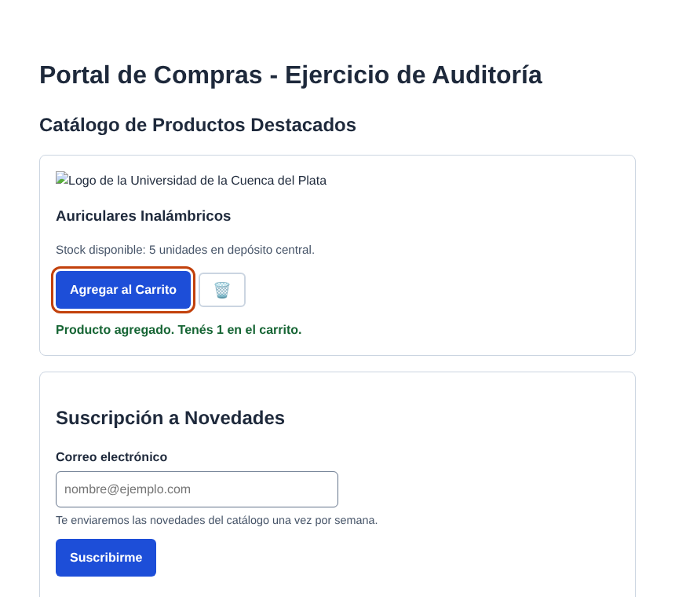

# Taller de Auditoría de Accesibilidad — "El engaño del 100%"

**Cátedra:** Paradigmas y Lenguajes de Programación III — UCP
**Alumno:** De Olivera Jesús

## Archivos

| Archivo | Qué es |
|---|---|
| [`original/index.html`](original/index.html) | Archivo entregado por la cátedra, sin cambios |
| [`nivel-1/index.html`](nivel-1/index.html) | **Etapa 1:** se corrigen solo los 5 errores de Lighthouse (100/100), pero se mantienen las barreras manuales |
| [`index.html`](index.html) | **Etapa 3:** versión final accesible, con las 4 reglas aplicadas |

> Para auditar con Lighthouse conviene abrir los archivos con **Live Server** (VS Code) o desde XAMPP (`http://localhost/...`), no con doble clic.

---

## ETAPA 1 — Auditoría automatizada con Google Lighthouse

**Configuración:** F12 → pestaña **Lighthouse** → solo la categoría **Accesibilidad** → *Analyze page load*.

### Puntuación inicial

| Versión | Puntuación de Accesibilidad |
|---|---|
| `original/index.html` | **___ / 100** ← completar con la captura de Lighthouse |
| `nivel-1/index.html` | **100 / 100** |
| `index.html` (final) | **100 / 100** |

### Los 5 errores marcados en rojo

| # | Auditoría de Lighthouse | Dónde estaba | Por qué es un problema | Corrección |
|---|---|---|---|---|
| 1 | **Background and foreground colors do not have a sufficient contrast ratio** (`color-contrast`) | `.texto-bajo-contraste` con `color: #94a3b8` sobre blanco | Contraste de **2,56:1**. WCAG AA exige **4,5:1** para texto normal: una persona con baja visión, o cualquiera con el sol sobre la pantalla, no lo lee | Color `#475569` → contraste de **7,6:1** |
| 2 | **Form elements do not have associated labels** (`label`) | `<input type="email" id="email-user">` con solo `placeholder` | El `placeholder` no es una etiqueta: desaparece al escribir y muchos lectores de pantalla no lo anuncian. El usuario ciego escucha "campo de edición" sin saber qué cargar | `<label for="email-user">Correo electrónico</label>` |
| 3 | **Image elements do not have `[alt]` attributes** (`image-alt`) | `` | El lector de pantalla lee la URL del archivo o "imagen" sin contexto | `alt="Logo de la Universidad de la Cuenca del Plata"` |
| 4 | **Buttons do not have an accessible name** (`button-name`) | Botón con solo el emoji 🗑️ | Se anuncia como "botón" (o "papelera") y no se entiende qué hace | `aria-label="Quitar Auriculares Inalámbricos del carrito"` y el emoji con `aria-hidden="true"` |
| 5 | **Heading elements are not in a sequentially-descending order** (`heading-order`) | Después del `<h1>` venía un `<h4>` | Los usuarios de lector de pantalla navegan saltando entre títulos: un salto de nivel hace pensar que falta contenido y rompe el índice de la página | `<h4>` → `<h2>`. Además, "Suscripción" pasa de `<h3>` a `<h2>` porque es una sección hermana del catálogo |

### Refactorización Nivel 1

En [`nivel-1/index.html`](nivel-1/index.html) se aplicaron **solo esas 5 correcciones**. Con eso Lighthouse marca **100/100**…
…pero la página sigue teniendo barreras graves, como se ve en la Etapa 2.

---

## ETAPA 2 — Auditoría manual: "El engaño del 100%"

### 1. Prueba de navegación por teclado (`Tab`)

Recorrido con `Tab` sobre la versión Nivel 1 (100/100 en Lighthouse):

```
1º Tab → botón 🗑️        (no se ve dónde está el foco)
2º Tab → campo de correo  (no se ve dónde está el foco)
3º Tab → botón Suscribirme (no se ve dónde está el foco)
"Agregar al Carrito" → nunca recibe el foco
```

**¿Logramos visualizar en qué elemento estamos posicionados?**
**No.** El CSS tiene esta regla:

```css
*:focus {
    outline: none !important;
}
```

Borra el anillo de foco de **todos** los elementos. Quien navega con teclado (personas con discapacidad motriz, usuarios de lectores de pantalla o de teclado) no sabe dónde está parado. Es como usar el mouse sin ver el puntero.

**¿Podemos accionar "Agregar al Carrito" con `Enter` o la `Barra espaciadora`?**
**No.** Ni siquiera se puede llegar con `Tab`: el foco salta directo al botón de la papelera.

**¿Por qué ocurre?** Porque no es un botón, sino un `<div>` con apariencia de botón:

```html
<div class="btn-falso" onclick="alert('Producto agregado')">Agregar al Carrito</div>
```

- Un `<div>` **no es enfocable**: no entra en el orden de tabulación.
- Un `<div>` **no responde al teclado**: el navegador solo convierte `Enter` y `Espacio` en un `click` en los elementos interactivos nativos (`<button>`, `<a>`, `<input>`).
- Un `<div>` **no tiene rol**: el lector de pantalla lo lee como texto común, no como botón.

El `onclick` solo funciona con el mouse. Para una persona que no puede usar el mouse, **no hay forma de comprar**.

**¿Por qué Lighthouse no lo detecta?** Lighthouse analiza el código de forma estática: ve un `<div>` con texto y no tiene manera de saber que visualmente "parece" un botón. Tampoco puede comprobar si el foco se ve, porque eso requiere navegar la página como una persona.

### 2. Prueba de asincronía y feedback visual (newsletter)

**¿El botón se deshabilita durante la petición `fetch()`?**
**No.** Durante los 2 segundos que dura la petición, el botón "Suscribirme" sigue activo. Si el usuario hace clic varias veces, por impaciencia o porque no ve ningún cambio, se envían **varias suscripciones iguales**. Tampoco hay ninguna señal en el botón de que algo se está procesando.

**Si una persona ciega usara un lector de pantalla, ¿se enteraría de que el mensaje cambió?**
**No.** El script cambia el texto del `<div id="resultado-servidor">`, pero el lector de pantalla solo lee lo que tiene el foco o lo que el usuario recorre. Un cambio en otra parte de la página es **silencioso**: la persona apretó "Suscribirme" y no sabe si funcionó, si falló o si sigue esperando.

**¿Qué atributo ARIA falta?**
**`aria-live="polite"`** en la región del mensaje. Convierte el `div` en una *región viva*: cada vez que su contenido cambia, el lector lo anuncia en cuanto el usuario termina lo que está escuchando (`polite`, sin interrumpir).

Se complementa con **`aria-atomic="true"`**, para que lea el mensaje **completo** y no solo la parte que cambió.

---

## ETAPA 3 — Refactorización integral

La versión final es [`index.html`](index.html).



### Regla 1 — HTML5 semántico

| Antes | Después |
|---|---|
| `<div class="btn-falso" onclick="...">` | `<button type="button" class="btn btn-primario" id="btn-agregar">` + `addEventListener('click', ...)` |
| `<input>` sin etiqueta | `<label for="email-user">` + `aria-describedby` con un texto de ayuda |
| `<h4>` suelto dentro de `<main>` | `<section aria-labelledby="titulo-catalogo">` con `<h2>`, y cada producto como `<article>` con `<h3>` |
| Sin pie | `<footer>` |

Además se agregó un enlace **"Saltar al contenido principal"**. Es lo primero que aparece al presionar `Tab` y permite ir directo al `<main>` sin recorrer el encabezado.

Con un `<button>` real, `Enter` y `Espacio` disparan el `click` **sin escribir código extra**. El navegador ya hace el trabajo.

### Regla 2 — Foco visual preservado

Se **eliminó** `*:focus { outline: none !important; }` y se agregó:

```css
:focus-visible {
    outline: 3px solid var(--foco);   /* #c2410c */
    outline-offset: 3px;
}
```

`:focus-visible` muestra el anillo **cuando se navega con teclado** y no al hacer clic con el mouse. Así se respeta la accesibilidad sin el "recuadro molesto" que suele llevar a borrar el `outline`. El color tiene un contraste de 4,6:1 contra el fondo blanco (WCAG pide 3:1 para indicadores de foco).

### Regla 3 — Comunicación asíncrona accesible

```html
<div id="resultado-servidor" class="mensaje" role="status" aria-live="polite" aria-atomic="true"></div>
```

```js
btnEnviar.disabled = true;            // no se puede volver a enviar mientras espera
btnEnviar.textContent = 'Enviando…';  // feedback visual
form.setAttribute('aria-busy', 'true');
try {
    const respuesta = await fetch(URL_SUSCRIPCION, { method: 'POST', ... });
    const datos = await respuesta.json();
    mostrar(respuestaUI, datos.mensaje, respuesta.ok ? 'exito' : 'error');
} catch (error) {
    mostrar(respuestaUI, 'No pudimos conectar con el servidor...', 'error');
} finally {
    btnEnviar.disabled = false;       // se rehabilita termine bien o mal
    btnEnviar.textContent = 'Suscribirme';
    form.removeAttribute('aria-busy');
}
```

- El bloque `finally` asegura que el botón vuelva a habilitarse también si la petición falla.
- Se agregó **validación accesible del correo**: si es inválido se marca el campo con `aria-invalid="true"`, el error se anuncia en la región viva y el foco vuelve al campo.
- El carrito también tiene su región `aria-live`, así que "Producto agregado. Tenés 1 en el carrito." se anuncia en lugar de usar `alert()`.

> **Sobre el `fetch()`:** el ejercicio no tiene servidor. En lugar del `setTimeout` suelto, el script **intercepta `fetch()`** y devuelve un objeto `Response` real con JSON después de 2 segundos. Así el código del formulario es el mismo que se usaría con un backend: para conectarlo a PHP alcanza con borrar el bloque "Servidor simulado" y apuntar `URL_SUSCRIPCION` a `api/suscripcion.php`.

### Regla 4 — Protección contra inyección

Todas las respuestas se insertan con **`textContent`**, mediante una única función:

```js
function mostrar(elemento, texto, tipo = '') {
    elemento.textContent = texto;   // nunca innerHTML
    elemento.className = `mensaje ${tipo}`.trim();
}
```

`textContent` inserta el valor como **texto plano**. Si el servidor, o un atacante que lo comprometiera, devolviera ``, se mostraría literalmente en pantalla y **no se ejecutaría**. Con `innerHTML` el navegador lo interpretaría como HTML y ejecutaría el código (XSS).

---

## Verificación

Se probaron las tres versiones con un navegador automatizado (Chromium + Playwright). Se revisaron las mismas reglas que audita Lighthouse y las pruebas manuales de la Etapa 2:

| Prueba | Original | Nivel 1 | Final |
|---|---|---|---|
| Contraste de texto (mín. 4,5:1) | ❌ 2,56:1 | ✅ | ✅ |
| Imágenes con `alt` | ❌ | ✅ | ✅ |
| Campos con `<label>` | ❌ | ✅ | ✅ |
| Botones con nombre accesible | ❌ | ✅ | ✅ |
| Orden de títulos | ❌ h1 → h4 | ✅ | ✅ |
| **Foco visible con `Tab`** | ❌ | ❌ | ✅ anillo de 3 px en los 5 elementos |
| **"Agregar al Carrito" con teclado** | ❌ no recibe foco | ❌ no recibe foco | ✅ funciona con `Enter` y con `Espacio` |
| **`aria-live` / `aria-atomic`** | ❌ | ❌ | ✅ `polite` / `true` |
| **Botón deshabilitado durante `fetch()`** | ❌ | ❌ | ✅ se deshabilita y se rehabilita al terminar |
| Errores en la consola | — | — | Ninguno |

**Conclusión:** la versión Nivel 1 obtiene **100/100 en Lighthouse** y aun así una persona que usa solo el teclado **no puede comprar** ni ve dónde está parada, y una persona ciega **no se entera** del resultado de la suscripción.

Las herramientas automáticas detectan solo una parte de los problemas de accesibilidad: lo que se puede deducir leyendo el código. El resto se comprueba **usando la página como la usaría una persona con discapacidad**: con el teclado y con un lector de pantalla (NVDA en Windows, VoiceOver en Mac). Un 100 en Lighthouse es el piso, no la meta.
