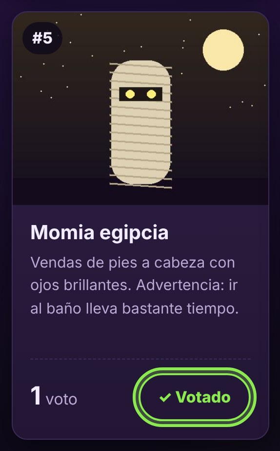
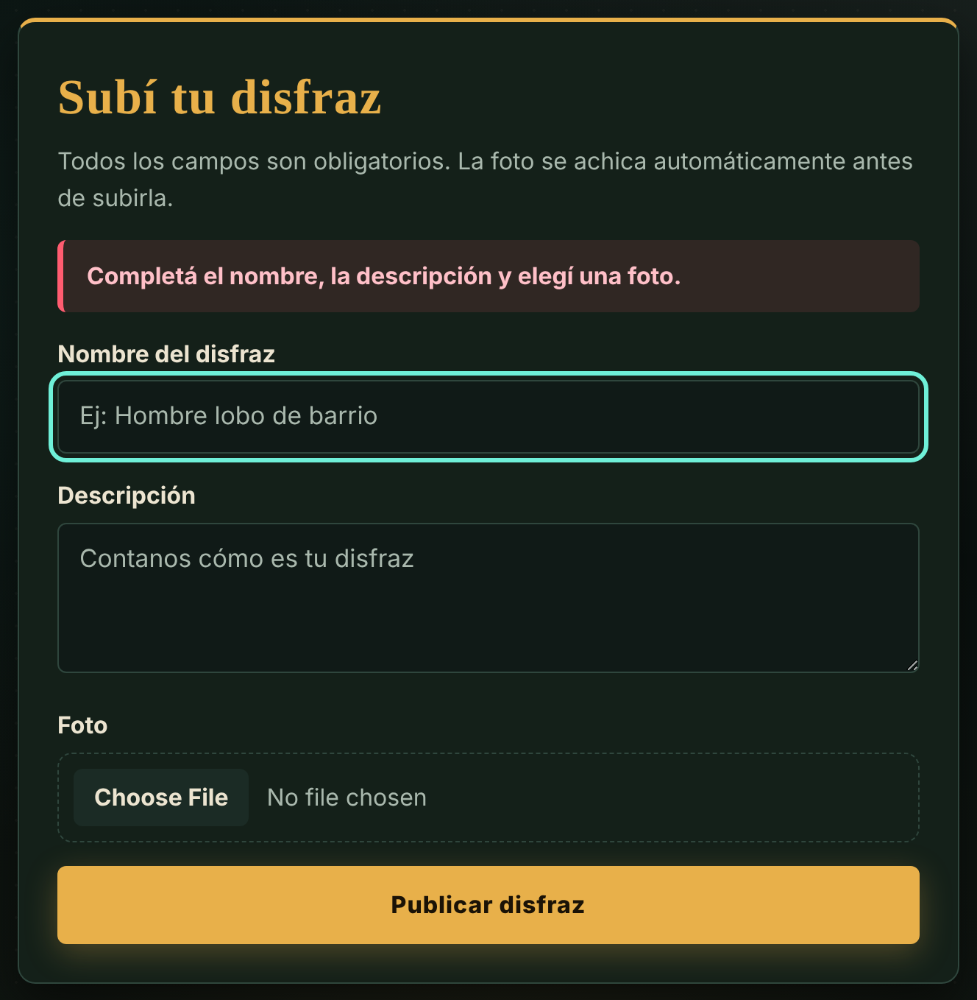

# 🎃 AA28 — La web del terror accesible

Evolución del proyecto **Noche de Disfraces** (AA25): la aplicación de votación de disfraces de Halloween con **API REST en PHP + MySQL**, convertida en un producto **accesible (WCAG 2.1 nivel AA)**, **probado** y **auditado con la norma ISO/IEC 25010**.

- **Frontend:** HTML, CSS y JavaScript Vanilla con `fetch`.
- **Backend:** PHP con PDO, consultas preparadas, contraseñas con BCRYPT y sesiones.

**Entregables de la AA28:**
- [`CALIDAD-ISO25010.md`](CALIDAD-ISO25010.md): Ficha de Autoevaluación de Calidad.
- [`tests/test_api.php`](tests/test_api.php): 30 pruebas automáticas de la API.
- [`docs/`](docs/): capturas de las pruebas de teclado y resultado de los tests.
- Informe en PDF: `AA28 - La web del terror accesible.pdf`.

---

## Instalación en XAMPP

1. Abrir el **XAMPP Control Panel** y encender **Apache** y **MySQL**.
2. Copiar esta carpeta dentro de `C:\xampp\htdocs\` y renombrarla **`halloween`**.
3. Entrar a **phpMyAdmin** (`http://localhost/phpmyadmin`) → pestaña **Importar** → elegir `sql/halloween.sql` → **Continuar**.
   - El script crea la base `halloween`, las 3 tablas, los usuarios de prueba y 6 disfraces con foto.
4. Abrir **`http://localhost/halloween/`**.

> **Contraseña de MySQL:** si tu MySQL tiene contraseña (XAMPP viene sin), cambiá `$pass` en `includes/conexion.php`.

### Usuarios de prueba

| Usuario | Contraseña | Rol |
|---|---|---|
| `admin` | `Halloween2026!` | Administrador: accede al panel `admin.php` |
| `ana` | `calabaza123` | Usuario (ya votó Calabaza, Fantasma y Vampiro) |
| `bruno` | `calabaza123` | Usuario |
| `carla` | `calabaza123` | Usuario |

---

## Refactorización de accesibilidad (AA28)

### Problemas encontrados en la versión AA25

La versión AA25 **ya daba 100/100 en Lighthouse** (ver [`docs/capturas/l-aa25.png`](docs/capturas/l-aa25.png)), pero al revisar el código y probar a mano aparecieron estos problemas, que la herramienta no detecta:

| # | Problema | Cómo se detectó | Pauta WCAG 2.1 |
|---|---|---|---|
| 1 | `aria-label` sobre un `<span>` sin rol (puesto del ranking): ARIA no lo permite en elementos genéricos y varios lectores lo ignoran | Revisión del código | 4.1.2 Nombre, función, valor |
| 2 | Filas de la papelera con `opacity: 0.55`: el texto quedaba con contraste de 2,3:1 y 3,3:1 (Lighthouse no lo ve porque borra la sesión al analizar) | Medición de contraste con un disfraz en la papelera | 1.4.3 Contraste (mínimo) |
| 3 | Al votar o eliminar con el teclado, la lista se volvía a dibujar y **el foco saltaba al principio de la página** | Prueba manual con Tab | 2.4.3 Orden del foco |
| 4 | No había forma de saltear el menú | Prueba manual con Tab | 2.4.1 Evitar bloques |
| 5 | Seis botones iguales "🎃 Votar" (y seis "Editar"), sin decir de qué disfraz son; el lector también leía los emojis | Revisión del árbol de accesibilidad | 2.4.6 Encabezados y etiquetas |
| 6 | Los errores de formulario no marcaban el campo ni le devolvían el foco | Prueba manual | 3.3.1 Identificación de errores |
| 7 | Un elemento con foco podía quedar tapado por la cabecera fija | Prueba manual con Tab | 2.4.7 Foco visible |
| 8 | En el celular el panel admin era más ancho que la pantalla (scroll horizontal) | Vista móvil de Chrome | 1.4.10 Reflow |

### Correcciones aplicadas

| Requisito de la consigna | Cambio | Archivo |
|---|---|---|
| **Lighthouse 100/100** (se mantiene; contraste, `label`, `alt`) | Puesto del ranking con texto oculto en lugar de `aria-label`; fila de la papelera sin `opacity`, distinguida con fondo y nombre tachado; color de la etiqueta "En papelera" a 6:1; `::placeholder` con contraste suficiente | `js/index.js`, `css/estilos.css` |
| **Navegación solo con teclado** | Enlace "Saltar al contenido principal" en las 4 páginas; todos los controles son `<button>` o `<a>` nativos (no hay `div` con `onclick`); **el foco vuelve al botón correspondiente** después de votar, editar, eliminar o restaurar; `scroll-padding-top` para que la cabecera fija no tape el foco | todos los `.html`, `js/index.js`, `js/admin.js` |
| **Navegación con flechas** | Además de Tab: ↓ y → pasan al elemento siguiente, ↑ y ← al anterior; manteniendo apretada la flecha el foco sigue avanzando. En campos de texto ← y → mueven el cursor, y `textarea`/`select` conservan sus flechas | `js/comun.js` |
| **Foco visible** | `:focus-visible` con contorno verde de 3 px (13:1 contra el fondo) y halo en los botones; no existe ningún `outline: none` | `css/estilos.css` |
| **Nombres accesibles** | Los botones dicen "Votar por Calabaza gigante", "Editar Bruja del bosque", etc. (texto oculto); los emojis van con `aria-hidden="true"`; `aria-current="page"` en el menú | `js/index.js`, `js/admin.js`, `js/comun.js` |
| **Comunicación asíncrona accesible** | Cada resultado de `fetch()` se anuncia en una región `aria-live="polite"` + `aria-atomic="true"` (estado de carga, alertas de formularios, aviso flotante); el texto se inyecta siempre con `.textContent`; los botones se deshabilitan mientras esperan la respuesta | `js/comun.js`, todas las páginas |
| **Vista en el celular** | `.admin-grilla > * { min-width: 0 }` y `position: relative` en el contenedor de la tabla: la tabla se desplaza dentro de su recuadro y la página no tiene scroll horizontal ni a 320 px | `css/estilos.css` |
| **Errores accesibles** | El campo con error recibe `aria-invalid="true"` y el foco, y el mensaje se anuncia | `js/comun.js`, `js/acceso.js`, `js/index.js`, `js/admin.js` |

### Recorrido de prueba solo con teclado

| Acción | Resultado |
|---|---|
| 1.er Tab en cualquier página | Aparece "Saltar al contenido principal"; con Enter el foco pasa al `<main>` |
| Tab hasta "Ingresar" → Enter → escribir usuario → Tab → clave → Enter | Inicia sesión. Con clave incorrecta el error se anuncia y el foco vuelve al campo contraseña |
| Tab hasta "Votar por Momia egipcia" → Enter | Se registra el voto, se anuncia "¡Voto registrado!" y **el foco queda en el mismo botón**, ahora "Votado" |
| Barra espaciadora sobre ese botón | Quita el voto; el foco sigue en el botón |
| Flechas ↓ / ↑ en cualquier página | El foco avanza o retrocede igual que con Tab / Shift+Tab |
| Enviar "Subí tu disfraz" vacío | El error se anuncia y el foco va al primer campo incompleto |
| Admin: "Editar" → Enter → cambiar el nombre → Enter | Se guarda y el foco vuelve al botón "Editar" de esa fila |
| Admin: "Eliminar" → Enter → Enter en la confirmación | El foco pasa a "Restaurar" de la misma fila |

<p>
  
  
</p>

---

## Pruebas automáticas

Con Apache y MySQL encendidos, desde la carpeta del proyecto:

```
C:\xampp\php\php.exe tests\test_api.php
```

Si la carpeta en `htdocs` tiene otro nombre: `C:\xampp\php\php.exe tests\test_api.php http://localhost/otro-nombre/`

El script hace 30 pruebas contra la API real:
- listado, detalle y fotos;
- inyección SQL y control anti-CSRF;
- registro, login con BCRYPT y cookie de sesión;
- voto, voto duplicado y quitar voto;
- permisos de usuario y admin, y archivo SVG malicioso;
- CRUD completo del administrador;
- tiempo de respuesta.

Termina con `Resultado: 30 de 30 pruebas aprobadas`. Ver [`docs/resultado-pruebas.txt`](docs/resultado-pruebas.txt).

> El script registra un usuario `test_xxxxxx` en cada ejecución (la API no permite borrar usuarios) y elimina el disfraz de prueba que crea.

---

## Guía para la demostración en clase (3 minutos)

1. **Teclado (1 min):** abrir `http://localhost/halloween/` y, sin tocar el mouse:
   - Tab → "Saltar al contenido";
   - Tab hasta "Ingresar" → Enter → `ana` / `calabaza123` → Enter;
   - Tab hasta un "Votar" → Enter. Mostrar que el foco se queda en el botón;
   - Espacio para quitar el voto.
2. **Lighthouse (1 min):** F12 → Lighthouse → solo *Accessibility* → mostrar el 100/100. Para cerrar: "la versión anterior también daba 100, y aun así tenía los problemas que encontramos a mano".
3. **Arquitectura (1 min):** la característica que más trabajo exigió fue **Usabilidad / Accesibilidad**. Al volver a dibujar la lista después de cada `fetch()`, el foco se perdía y saltaba al principio de la página. Se resolvió devolviendo el foco al botón correspondiente después de cada operación (ver [`CALIDAD-ISO25010.md`](CALIDAD-ISO25010.md)).

---

## API REST

Todas las respuestas son JSON con la forma `{ "estado": "exito" | "error", ... }` y usan el **código HTTP** que corresponde.

| Método | Ruta | Qué hace | Acceso |
|---|---|---|---|
| `GET` | `api/disfraces.php` | Lista de disfraces visibles, ordenada por votos. Incluye `votado: true/false` para el usuario logueado | Público |
| `GET` | `api/disfraces.php?id=5` | Un disfraz | Público |
| `GET` | `api/disfraces.php?todos=1` | Todos, incluidos los de la papelera | Admin |
| `POST` | `api/disfraces.php` | Crear disfraz (`multipart/form-data`: nombre, descripcion, foto) | Usuario logueado |
| `PUT` | `api/disfraces.php?id=5` | Modificar nombre, descripción, foto o restaurar (`eliminado: 0`) | Admin |
| `DELETE` | `api/disfraces.php?id=5` | Enviar a la papelera (borrado lógico) | Admin |
| `DELETE` | `api/disfraces.php?id=5&definitivo=1` | Borrar de la base (solo si ya está en la papelera) | Admin |
| `GET` | `api/foto.php?id=5` | Imagen del disfraz, leída del BLOB | Público |
| `GET` | `api/votos.php` | Ids de los disfraces que votó el usuario | Usuario logueado |
| `POST` | `api/votos.php` `{ "id_disfraz": 5 }` | Votar | Usuario logueado |
| `DELETE` | `api/votos.php?id_disfraz=5` | Quitar el voto | Usuario logueado |
| `POST` | `api/registro.php` `{ "nombre", "clave" }` | Crear cuenta e iniciar sesión | Público |
| `POST` | `api/login.php` `{ "nombre", "clave" }` | Iniciar sesión | Público |
| `POST` | `api/logout.php` | Cerrar sesión | — |
| `GET` | `api/sesion.php` | Quién está logueado (para armar el menú) | Público |

**Códigos usados:**

| Código | Significado |
|---|---|
| 200 | OK |
| 201 | Creado |
| 400 | Datos inválidos |
| 401 | Sin sesión |
| 403 | Sin permiso |
| 404 | No existe |
| 405 | Método no permitido |
| 409 | Duplicado (voto repetido o usuario ya registrado) |
| 413 | Imagen muy pesada |
| 415 | Formato de imagen no permitido |

> **PUT con imagen:** los archivos solo se pueden enviar con `POST`. Por eso, para modificar un disfraz con foto nueva, el frontend envía `POST` + la cabecera `X-HTTP-Method-Override: PUT`, y la API lo trata como un `PUT`.

---

## Seguridad

| Riesgo | Cómo se resuelve |
|---|---|
| **Inyección SQL** | Todas las consultas usan **PDO con consultas preparadas** (`prepare` + `bindValue`) y `ATTR_EMULATE_PREPARES = false` |
| **Contraseñas expuestas** | Se guardan con **`password_hash` (BCRYPT)** y se verifican con `password_verify`. El login responde igual si falla el usuario o la clave, y tarda lo mismo aunque el usuario no exista |
| **Acceso sin permiso** | **Sesiones PHP**: votar exige sesión (401) y el CRUD exige ser admin (403). `admin.php` se protege en el servidor, así que su HTML nunca llega a quien no es administrador |
| **Robo de sesión** | Cookie `HttpOnly` + `SameSite=Strict`, `session_regenerate_id(true)` al ingresar y `use_strict_mode` |
| **XSS** | Todo lo que escriben los usuarios se muestra con **`textContent`**, nunca con `innerHTML`. Se probó con un disfraz llamado ``: se ve como texto |
| **CSRF** | Las peticiones que modifican datos deben traer la cabecera `X-Requested-With: fetch`, que un formulario de otro sitio no puede agregar. Además la cookie es `SameSite=Strict` |
| **Archivos maliciosos** | El tipo de imagen se detecta leyendo el **contenido** (`getimagesizefromstring`), no la extensión. Solo se aceptan JPG, PNG, GIF y WEBP (SVG rechazado). `foto.php` responde con `Content-Security-Policy: default-src 'none'` |
| **Archivos internos** | `includes/` y `sql/` tienen un `.htaccess` con `Require all denied` |
| **Errores** | El detalle técnico va al log del servidor (`error_log`); al usuario solo le llega un mensaje genérico |

---

## Decisiones de diseño

- **Quién es administrador:** la tabla `usuarios` del enunciado no tiene columna de rol, así que el administrador se define en `includes/sesion.php`:

  ```php
  const ADMINISTRADORES = ['admin'];
  ```

  Nadie puede registrarse con ese nombre.
- **Columna `foto` (varchar 20):** guarda el **tipo MIME** de la imagen (`image/jpeg`, `image/png`…). `foto.php` lo usa para servir el BLOB con la cabecera correcta.
- **Límite de 64 KB del BLOB:** una columna `BLOB` admite como máximo 65.535 bytes. Por eso, antes de subir, el navegador **achica y comprime la foto a JPEG por debajo de 60 KB** (`comprimirImagen()` en `js/comun.js`). Se probó con un PNG de 6 MB. El servidor igual rechaza cualquier archivo de más de 64 KB.
- **Votos:** cada usuario puede votar **una vez por cada disfraz**. Puede votar varios disfraces distintos y también **quitar su voto**.
  - La columna `disfraces.votos` y la tabla `votos` se actualizan en la misma **transacción**, así nunca quedan desfasadas.
- **Borrado lógico:** "Eliminar" usa la columna `eliminado` del enunciado. El disfraz deja de mostrarse pero conserva sus votos y se puede **restaurar**. Desde la papelera se puede borrar definitivamente.
- **Fotos de usuarios:** cualquier usuario registrado puede publicar su disfraz, con foto obligatoria. El administrador modera desde el panel.

---

## Estructura

```
halloween/
├── index.html          → ranking, votación y "Subí tu disfraz"
├── login.html          → inicio de sesión
├── registro.html       → registro de usuarios
├── admin.php           → panel de administración (protegido en el servidor)
├── api/
│   ├── disfraces.php   → CRUD de disfraces
│   ├── votos.php       → votar / quitar voto
│   ├── foto.php        → sirve la imagen guardada en el BLOB
│   ├── registro.php · login.php · logout.php · sesion.php
├── includes/           → conexión PDO, sesión y utilidades de la API (no accesible por URL)
├── js/
│   ├── comun.js        → cliente fetch, menú según la sesión, compresión de imágenes
│   ├── index.js · acceso.js · admin.js
├── css/estilos.css
├── sql/halloween.sql   → base de datos con datos de prueba
├── tests/test_api.php  → 30 pruebas automáticas de la API (se ejecuta con php)
├── docs/               → capturas y resultado de las pruebas
└── CALIDAD-ISO25010.md → ficha de autoevaluación de calidad
```

---

## Pruebas realizadas

- **API:** las 30 pruebas de `tests/test_api.php` (ver la sección *Pruebas automáticas*).
- **Accesibilidad:** con un navegador automatizado (Chromium) se revisaron las 5 vistas:
  - inicio como visitante y como usuario, ingreso, registro y panel admin;
  - con las mismas reglas que audita Lighthouse: contraste, `alt`, `label`, nombres accesibles de botones y enlaces, atributos ARIA, orden de títulos e ids duplicados.

  Resultado: **sin errores**, y en todos los elementos el foco es visible con Tab.
- **Teclado:** se hizo el recorrido completo de la tabla *Recorrido de prueba solo con teclado* sin usar el mouse.

> Las pruebas se hicieron con el servidor de PHP y una base SQLite con la misma estructura, porque en el entorno de desarrollo no había MySQL. En XAMPP se usa MySQL con `sql/halloween.sql`. La puntuación de Lighthouse se verifica en Chrome sobre XAMPP.
